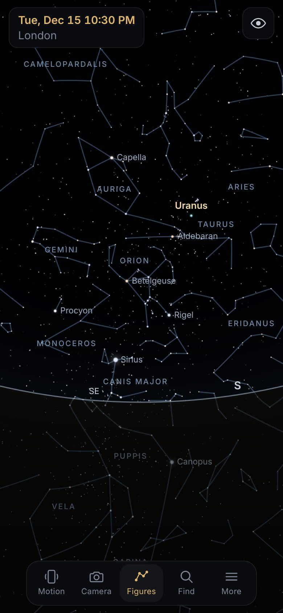
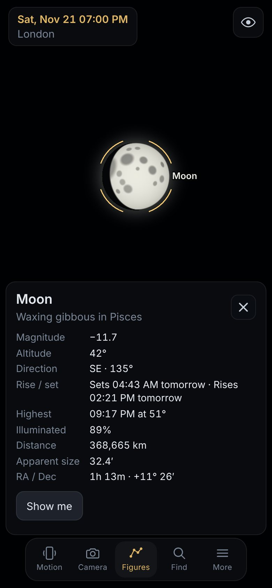
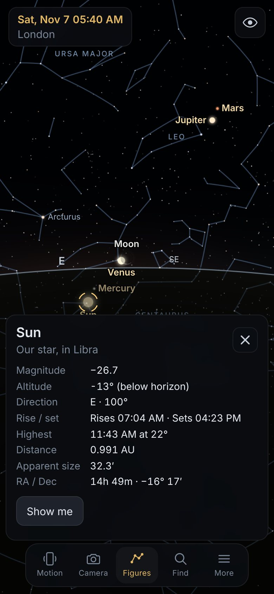
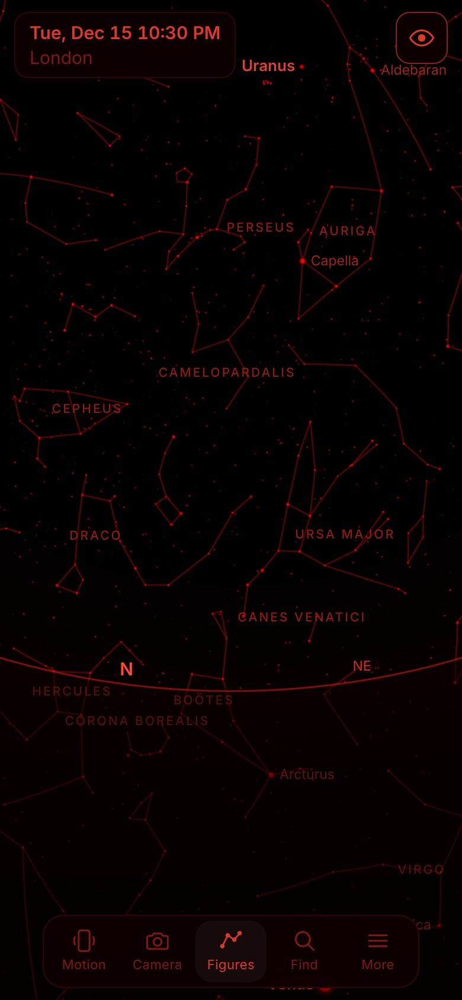

# Star Sky

An offline planetarium for your phone, in the spirit of the classic *Night Sky*
apps. Point your phone at the sky (or just drag around) to see the bright stars,
the constellations, the Moon and the planets for your location and time. Turn on
the camera and the same sky appears as a HUD over the live view.

It is a Progressive Web App: plain HTML, CSS and JavaScript with **no runtime
dependencies, no build step, no accounts and no network access after the first
load**.

| Night sky | Moon close-up | Dawn, looking below the horizon | Red-light mode |
| --- | --- | --- | --- |
|  |  |  |  |

## Features

- **Realistic sky**: 8,404 stars down to magnitude 6.5 with true colours, 333 IAU
  star names, all 88 constellations (figures, names and boundaries), the Sun, the
  Moon with its correct phase and orientation, and all seven planets.
- **Daylight and twilight**: the sky brightens with the Sun's altitude; turn it off
  to keep a dark sky all day.
- **Virtual sky mode (default)**: look anywhere, including straight up and down at
  your feet. The ground is translucent, so stars, planets, the Moon and the Sun stay
  visible as dimmed dots with labels when they are below the horizon. Watch the Sun
  and planets climb towards the horizon before dawn.
- **Motion mode**: the view follows the phone (gyroscope + compass, with magnetic
  declination from the World Magnetic Model 2025).
- **Camera overlay mode**: labels and figures drawn over the rear camera. If the
  camera permission is refused or there is no camera, it falls back to the virtual
  sky with a short message.
- **Calibration**: drag to align the sky with reality, or point the phone at true
  north and tap *This is north*. Works even on devices without a compass.
- **Interaction**: drag (with inertia) to look around, pinch or scroll to zoom
  (2°–120°), tap anything for details (magnitude, altitude/direction, rise/set,
  highest point, phase, distance, size, spectral type, constellation). Tap empty
  sky to identify the constellation you are looking at.
- **Find**: search planets, named stars and constellations; *Show me* turns the view
  to the object, and in motion mode an arrow at the screen edge guides you to it.
- **Time travel**: step by minutes, hours or days, or jump to any date.
- **Location**: GPS (works without internet), a list of 1,251 cities, manual
  coordinates, or an automatic estimate from the time zone on first launch.
- **Red-light mode** for night vision: every pixel, including the camera image and
  the interface, becomes dim red.
- **Display options**: magnitude limit, constellation figures and names, star names,
  objects below the horizon, alt/az and equatorial grids, ecliptic, keep screen on.

## Running it

Any static web server works. From the repository:

```sh
npm start            # http-server on http://localhost:8080
# or: python3 -m http.server 8080
```

Motion sensors, the camera and offline caching need a *secure context*: `localhost`
on a computer, or **HTTPS** when you open it on a phone. To try it on a phone, host
the folder on any static HTTPS host. The repository includes a manual GitHub Pages
workflow: enable *Settings → Pages → Source: GitHub Actions*, then run
*Actions → Deploy to GitHub Pages*.

Then on the phone open the URL once and choose **Add to Home Screen** (Safari) or
**Install app** (Chrome). From then on it starts full screen and works with no
connection at all.

## Using it

| Action | How |
| --- | --- |
| Look around | Drag (flick for inertia). Arrow keys on a computer. |
| Zoom | Pinch, mouse wheel, `+` / `-` |
| Details | Tap a star, planet or the Moon; tap empty sky for the constellation |
| Follow the phone | **Motion** (iOS asks for motion access the first time) |
| Camera overlay | **Camera** (starts motion tracking too). Pinch in this mode to match the overlay to your camera's field of view, drag sideways to fine-tune the direction. |
| Calibrate | **More → Calibrate direction**: drag left/right, or face true north and tap *This is north* |
| Constellations | **Figures** toggles figures and names |
| Red light | Eye button, top right |
| Time and place | Tap the clock, top left |

Times are shown in the phone's time zone.

## Privacy and permissions

Nothing leaves the device. There are no analytics, accounts or network requests.
Permissions are only requested when you use the matching feature:

- **Motion sensors**: for motion and camera modes (iOS shows a prompt; Android grants it by default).
- **Camera** (optional): only while the camera overlay is on; the stream is stopped
  when you switch it off or leave the app.
- **Location** (optional): only when you tap *Use my location*; otherwise a city or
  coordinates you enter. Stored in `localStorage` on the device.

## Accuracy

Low-precision but stable formulae, checked in `test/astro.test.mjs` against
worked examples in Meeus' *Astronomical Algorithms*, the official WMM2025 test values,
and the high-precision [astronomy-engine](https://github.com/cosinekitty/astronomy)
library:

| Quantity | Method | Worst error found (1950–2100) |
| --- | --- | --- |
| Moon | Meeus ch. 47 (truncated ELP-2000/82), topocentric | < 0.2′ |
| Sun | Meeus ch. 25 | < 0.6′ |
| Mercury, Venus, Mars, Neptune | JPL Keplerian elements (Standish) | 0.7′ – 3.2′ |
| Jupiter, Saturn, Uranus | Schlyter elements + main perturbations | 1.8′ – 3′ |
| Rise / set times (Sun, Moon, Jupiter) | Altitude search with refraction | < 2 min |
| Magnetic declination | WMM2025 spherical harmonics | < 0.01° |

Stars use the J2000 catalogue with proper motion and precession applied for the
current date. Refraction is applied near the horizon. Nutation and aberration
(< 20″) are ignored.

## Performance and battery

- WebGL draws stars as a single point batch and lines as GPU-projected quads.
  Geometry is uploaded once, so a frame only changes a few uniforms (about 0.2 ms of
  JavaScript per frame).
- **Rendering on demand**: nothing is drawn while the view is still. The sky clock
  ticks only as often as the Earth's rotation moves the stars by half a pixel at the
  current zoom (every 1–30 s), and the motion filter skips frames while the phone is at rest.
- The sky canvas is capped at 1.5× device pixels, the camera at 720p/30 fps.
  Sensors, camera, timers and the wake lock are released when the app is hidden.
- The JSON data adds up to about 500 kB (about 180 kB gzipped).

## Project layout

```
index.html, css/app.css     App shell and dark / red-light UI
js/main.js                  Boot + service worker registration
js/app.js                   Controller: sky state, modes, input, render loop
js/astro/                   Time, coordinates, Sun, Moon, planets, rise/set, WMM
js/catalog.js               Star / constellation data in the date frame
js/render/                  View & projection, WebGL renderer, shaders, labels
js/sensors/                 Device orientation fusion, camera feed
js/input/gestures.js        Drag, pinch, tap, wheel
js/ui/                      DOM panels and formatting
data/                       Generated catalogues (see tools/)
sw.js                       Generated offline service worker
tools/                      Data, icon and service-worker generators
test/                       Unit tests (node:test) and the browser e2e test
```

## Development

```sh
npm install          # dev dependency used by tests only (astronomy-engine)
npm test             # unit tests: astronomy accuracy, projection, sensors, sw.js up to date
npm run test:e2e     # headless Chromium (Playwright): rendering, taps, sensors, camera, offline
```

After changing any app file, regenerate the service worker so the offline cache
updates (`npm test` fails if you forget):

```sh
npm run build:sw
```

To rebuild the data from the original catalogues:

```sh
bash tools/fetch-sources.sh && npm run build:data
```

## Known limitations

- iOS reports compass headings in a way that varies with how the phone is held; the
  app only trusts readings taken where they are unambiguous. If the sky looks rotated,
  use *Calibrate direction* once.
- The camera's field of view cannot be read from the browser; a typical value (66°)
  is assumed and can be adjusted with a pinch in camera mode or in *More*.
- No Milky Way, deep-sky objects, comets or satellites in this first version.

## Credits

Data and algorithm sources, with their licences, are listed in [NOTICE.md](NOTICE.md).
